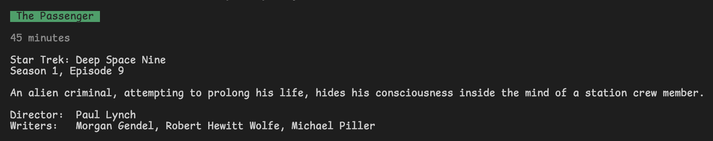
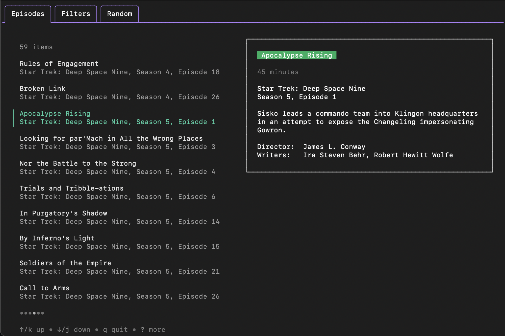
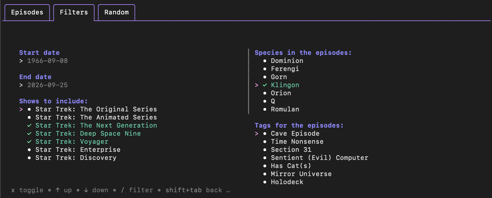
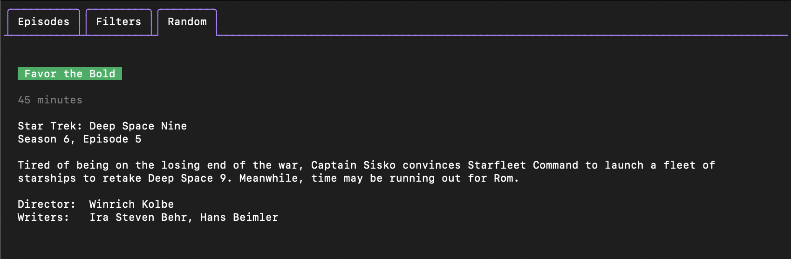

# I Need Star Trek
Sometimes I want to watch Star Trek, but I'm indecisive, so a random episode selector felt like it could be useful.

## Usage
`i-need-star-trek` is a tool to select random Star Trek episodes to watch. It can be used in two ways: as a command with flags in the terminal or as a terminal user interface (TUI).

### Command
Using the root command `i-need-star-trek` will simply return a random episode of Star Trek.

```
Usage:
  i-need-star-trek [flags]

Flags:
      --end-date time     end date for possible episodes
  -h, --help              help for i-need-star-trek
      --max-length int    max episode length in minutes
      --min-length int    min episode length in minutes
  -s, --shows strings     show to filter on
  -p, --species strings   major species in the episode
      --start-date time   start date for possible episodes
  -t, --tag strings       episode tags to filter on
```



### TUI

Using the command `i-need-star-trek interactive` will open an interface that allows the user to select filters, view all episodes that fit the filters, and select random episodes that fit the filters.

```
Usage:
  i-need-star-trek interactive [flags]

Aliases:
  interactive, i, tui

Flags:
  -h, --help   help for interactive
```






